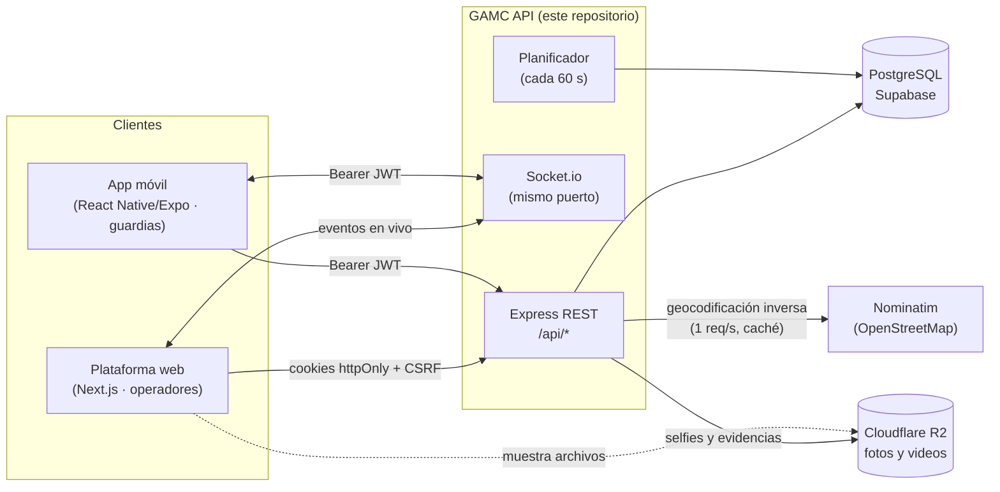
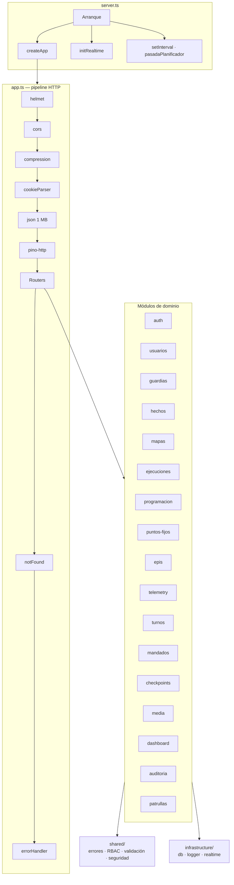
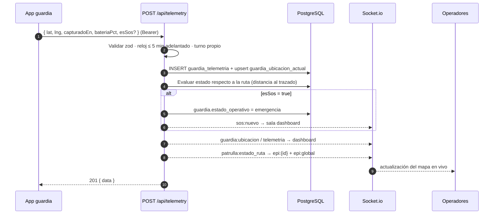
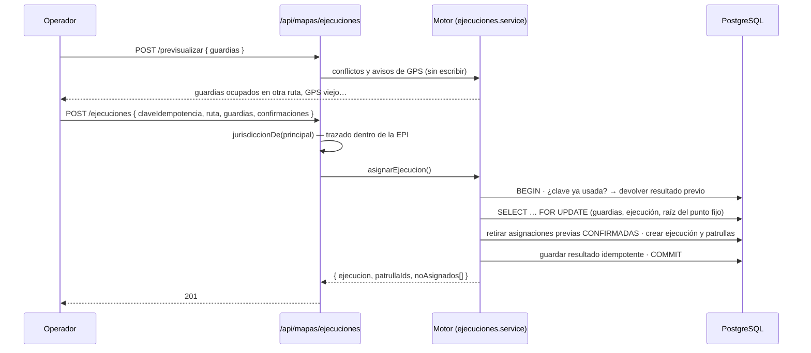

# 01 · Arquitectura

> **Alcance:** visión de sistema del backend GAMC — contexto, componentes, capas, módulos y flujos críticos.
> **Audiencia:** todo el equipo técnico.

---

## 1. Contexto del sistema

| Actor | Canal | Autenticación |
|---|---|---|
| **Operador / Admin / Super Admin** | Plataforma web | Cookies httpOnly `gamc_access` / `gamc_refresh` + header `x-csrf-token` |
| **Guardia municipal** | App móvil | `Authorization: Bearer <jwt>`; tokens devueltos en el cuerpo JSON |
| **Sistema** | Planificador interno | Opera en nombre del sistema (`creado_por_tipo = 'sistema'`) |

## 2. Principios de diseño

1. **El backend es la defensa real.** El frontend solo oculta opciones por experiencia de usuario; toda autorización (rol, permiso y territorio) se valida en el servidor.
2. **Una intención, una transacción.** Las operaciones de negocio (asignar una ruta a un grupo, retirar a un guardia, cerrar un horario) se ejecutan en una única transacción con bloqueos de fila; nunca quedan a medias.
3. **Idempotencia en operaciones críticas.** El motor de asignación exige `claveIdempotencia` (UUID): un reintento de red no duplica asignaciones.
4. **HTTP es la fuente de verdad; WebSocket es el canal de empuje.** Toda información emitida por socket es recuperable por REST (los clientes mantienen un polling de respaldo).
5. **Configuración validada al arranque.** Si una variable de entorno es inválida, el proceso no arranca (`src/config/env.ts`).
6. **Fallar cerrado.** Una cuenta sin EPI o con EPI inactiva nunca se interpreta como alcance global (`403`).
7. **Migraciones aditivas, idempotentes y reversibles**, con precondiciones y verificación posterior en el mismo SQL.

## 3. Vista de componentes

### 3.1 Capas

El código se organiza en cuatro capas con dependencias en un solo sentido:

| Capa | Ubicación | Responsabilidad | Puede depender de |
|---|---|---|---|
| **Presentación (HTTP)** | `modules/*/…routes.ts`, `modules/auth/http/` | Rutas Express, validación de entrada (zod), autenticación/autorización, forma de la respuesta | Aplicación, shared |
| **Aplicación** | `modules/*/…service.ts`, `modules/auth/application/` | Casos de uso, reglas de negocio, transacciones, auditoría, publicación de eventos | Dominio, infraestructura, shared |
| **Dominio** | `modules/auth/domain/`, funciones puras (`estadoRuta.ts`, `geometria.ts`, `ocupacion.ts`) | Contratos (repositorios), entidades y cálculos sin E/S | Nada externo |
| **Infraestructura** | `src/infrastructure/`, `modules/auth/infrastructure/` | Prisma, Socket.io, logger, almacenamiento de archivos (Cloudflare R2) | Librerías externas |

> **Nota:** el módulo `auth` implementa el patrón completo (puertos y adaptadores, con `InMemoryAuthRepository` para pruebas). El resto de módulos usa una variante simplificada *routes + service* que accede a Prisma directamente; las funciones de cálculo críticas se mantienen puras y probadas por separado.

### 3.2 Composition root

`src/composition.ts` es el único lugar donde se instancian dependencias compartidas (`TokenService`, `AuthService` con su repositorio Prisma, auditoría y transacciones). Los routers las reciben por parámetro (`buildXRouter(tokens)`), lo que evita singletons ocultos en la capa HTTP.

## 4. Catálogo de módulos

| Módulo | Prefijo HTTP | Responsabilidad | Consumidor |
|---|---|---|---|
| `auth` | `/api/auth`, `/api/mobile/auth` | Login, refresh rotativo, logout, recuperación, cambio de contraseña, activación de guardias | Web · Móvil |
| `usuarios` | `/api/usuarios` | Cuentas del personal (roles web) y su EPI | Web |
| `guardias` | `/api/guardias` | Dotación, estados de cuenta y operativo, atención de SOS | Web |
| `hechos` | `/api/hechos` | Incidentes: alta móvil, bandeja, filtros, exportación, clasificación EPI | Web · Móvil |
| `mapas` | `/api/mapas` | Ubicaciones, jurisdicción, biblioteca de rutas, ejecuciones, zonas críticas, heatmap, recorrido | Web |
| `ejecuciones` | *(sin router propio)* | Motor de asignación, estado de ruta, plazo de incorporación | `mapas`, `programacion`, `telemetry` |
| `programacion` | `/api/programaciones` | Programaciones semanales, agenda, planificador, asignación automática | Web |
| `puntos-fijos` | `/api/puntos-fijos` | Catálogo jerárquico de puntos fijos y su ocupación | Web |
| `epis` | `/api/epis` | Catálogo de EPIs, territorios versionados, módulos policiales, geometría | Web · Móvil |
| `telemetry` | `/api/telemetry` | Ingesta GPS/SOS desde la app | Móvil |
| `turnos` | `/api/turnos` | Inicio/cierre de turno con selfie, recorrido GPS | Móvil · Web |
| `mandados` | `/api/mandados` | Tareas registradas por guardias | Móvil · Web |
| `checkpoints` | `/api/checkpoints` | Marcas fotográficas de control | Móvil |
| `patrullas` | `/api/patrullas` | Patrulla vigente del guardia | Móvil |
| `media` | `/api/media` | Subida de fotos y videos a Cloudflare R2 | Móvil · Web |
| `dashboard` | `/api/dashboard` | KPIs y series agregadas | Web |
| `auditoria` | `/api/auditoria` | Bitácora de acciones sensibles | Web |

## 5. Flujos críticos

### 5.1 Ping GPS y SOS (ruta caliente)

Frecuencia esperada: un ping cada **45–90 s** por guardia en servicio.

### 5.2 Asignación de ruta a un grupo

Detalle completo en [05 · Dominio de patrullaje](05-dominio-patrullaje.md).

### 5.3 Planificador de servidor

Corre en el proceso del API cada `PLANIFICADOR_INTERVALO_MS` (60 s), con protección contra solapamiento. Cada pasada: **cierra** lo vencido → **abre** horarios que empiezan en 15 min → **asigna automáticamente** donde falte cupo → **inicia** los horarios que llegaron a su hora → revisa **plazos de incorporación**. Es seguro con varias instancias (índices únicos + `FOR UPDATE SKIP LOCKED`). Se desactiva por instancia con `DESACTIVAR_VENCIMIENTO_RUTAS=1`.

## 6. Decisiones arquitectónicas relevantes

| # | Decisión | Motivo | Consecuencia |
|---|---|---|---|
| ADR-01 | Monolito modular en un solo proceso (HTTP + WS + planificador) | Un único despliegue y latencia mínima entre la ingesta GPS y el empuje en vivo | Módulos con fronteras claras, separables si el volumen lo exige |
| ADR-02 | JWT de acceso corto con permisos embebidos (`perms`) | RBAC sin consultar la BD en cada request; el middleware de Next.js puede validarlo | Un cambio de permisos tarda hasta `ACCESS_TOKEN_MINUTES` en aplicarse (las conexiones WS se cierran explícitamente al cambiar la EPI) |
| ADR-03 | Refresh opaco, hasheado (SHA-256) y rotativo por familia | Detección de reuso: un token ya rotado revoca toda la familia | Una sola sesión válida por cadena de refresh |
| ADR-04 | Geometría propia en TypeScript, sin PostGIS | Compatible con Supabase sin extensiones; cálculos a escala de ciudad | Proyección equirectangular aproximada; suficiente para Cochabamba |
| ADR-05 | Fotos y videos en Cloudflare R2 (API S3) con URL pública por archivo | Independiente del servidor: sobrevive a reinicios y despliegues, sin costo de egreso, CDN de Cloudflare | La BD guarda solo la URL; el nombre de cada archivo es un UUID generado por el servidor |
| ADR-06 | Snapshot del trazado en cada ejecución | Editar una ruta de la biblioteca no altera lo ya asignado | Duplicación controlada de geometría |
| ADR-07 | Hora oficial `America/La_Paz` para programaciones | Bolivia no tiene horario de verano; agenda en día local | Fechas `fecha_local` tipo `date`, instantes en `timestamptz` |
