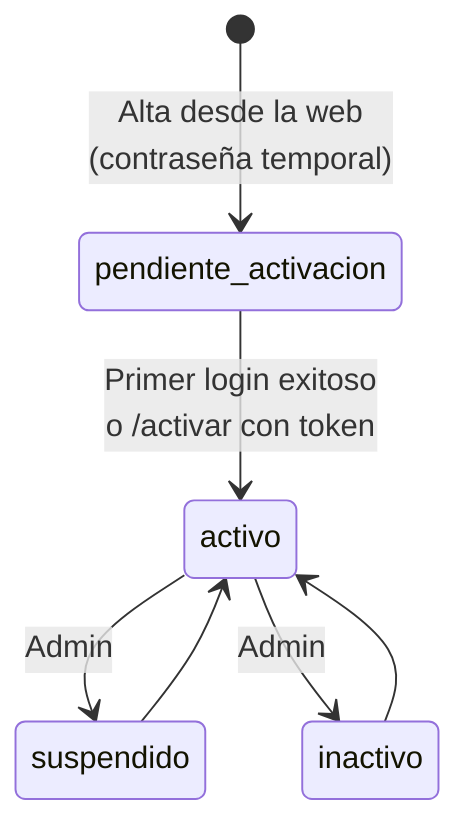
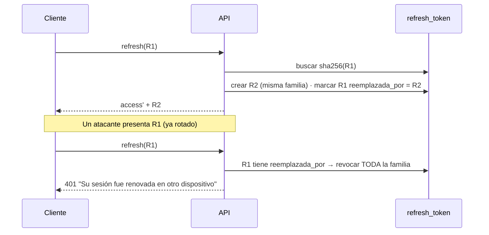

# 03 · Seguridad

> **Alcance:** modelo de identidad, sesiones, autorización (RBAC + territorio), controles de plataforma y obligaciones operativas.
> **Audiencia:** backend, seguridad, auditoría interna.

---

## 1. Resumen de controles

| Dominio | Control | Implementación |
|---|---|---|
| Identidad | Contraseñas con bcrypt (cost 12) | `password.service.ts` |
| Identidad | Política de fortaleza única (8–72, mayús., minús., número, símbolo) | `auth.schemas.ts → PasswordPolicy` |
| Sesión | JWT de acceso HS256 corto (`iss = gamc-api`) | `token.service.ts` (`jose`) |
| Sesión | Refresh opaco de 48 bytes, guardado como SHA-256, rotativo con detección de reuso | `auth.service.ts`, tabla `refresh_token` |
| Sesión | Cookies `httpOnly`, `SameSite=Lax`, `Secure` configurable | `shared/cookies.ts` |
| CSRF | Doble envío cookie `gamc_xsrf` ↔ header `x-csrf-token`, comparación en tiempo constante | `csrfGuard` |
| Autorización | RBAC `recurso × {ver, crear, editar, eliminar}` | `shared/policies.ts → can()`, `authorize()` |
| Autorización | Segmentación territorial por EPI, que falla cerrado | `modules/mapas/jurisdiccion.ts` |
| Abuso | Rate limiting en login, activación y recuperación | `express-rate-limit` |
| Plataforma | Cabeceras seguras, CORS por lista blanca, cuerpo ≤ 1 MB | `helmet`, `config/cors.ts` |
| Archivos | Cloudflare R2; nombre UUID generado en servidor, extensión por lista blanca de MIME, 25 MB | `media.storage.ts` |
| Trazabilidad | Bitácora de acciones sensibles | `audit_log`, `logAudit()` |
| Configuración | Validación estricta de entorno al arranque | `config/env.ts` |

## 2. Identidades

El sistema distingue dos **sujetos** (`sujeto_auth`):

| Sujeto | Tabla | Canal | Roles |
|---|---|---|---|
| `user` | `user` | Web (cookies) | `super_admin`, `admin`, `operador_monitoreo` |
| `guardia` | `guardia` | App móvil (Bearer) | `guardia` (sin matriz de permisos) |

Los endpoints exclusivos de la app usan `requireGuardia` (claim `tipo = 'guardia'`). Un guardia **nunca** puede actuar en nombre de otro: el `guardiaId` siempre se toma del JWT.

### 2.1 Ciclo de vida de la cuenta de guardia



`inactivo` y `suspendido` bloquean login y refresh (`403 ACCOUNT_DISABLED`).

## 3. Sesiones

### 3.1 Web (cookies)

| Cookie | httpOnly | Vida | Propósito |
|---|---|---|---|
| `gamc_access` | Sí | `ACCESS_TOKEN_MINUTES` (15 min) | JWT de acceso; lo validan el API y el middleware de Next.js |
| `gamc_refresh` | Sí | `REFRESH_TOKEN_DAYS` (7 días) | Token opaco para `/auth/refresh` |
| `gamc_profile` | No | 7 días | Espejo no sensible (nombre, rol) para la UI |
| `gamc_xsrf` | No | 7 días | Token anti-CSRF que la web reenvía en `x-csrf-token` |

Todas con `SameSite=Lax`, `Path=/` y `Secure = COOKIE_SECURE`.

### 3.2 Móvil (Bearer)

`accessToken` y `refreshToken` viajan en el JSON y la app los guarda en almacenamiento seguro del dispositivo. El CSRF no aplica (no hay credencial ambiente).

### 3.3 Rotación y detección de reuso



### 3.4 Contenido del JWT de acceso

```json
{ "sub": "<uuid>", "tipo": "user", "rol": "admin", "ident": "carlos.mendoza",
  "nombre": "Carlos Mendoza", "perms": { "hechos": { "ver": true, "editar": true, … } },
  "iss": "gamc-api", "exp": … }
```

Los permisos se embeben para autorizar sin consultar la BD. **Consecuencia:** un cambio en `role_permission` se aplica cuando el usuario renueva su token (≤ 15 min). Para revocación inmediata, suspender la cuenta (bloquea el siguiente refresh).

> **Requisito de integración:** `JWT_SECRET` debe ser **idéntico** en el backend y en el frontend web (el middleware de Next.js verifica el mismo token).

### 3.5 Recuperación de contraseña

- Código de 6 dígitos, guardado como SHA-256, de un solo uso, vigencia `RESET_CODE_MINUTES` (10 min).
- Respuesta idéntica exista o no la cuenta (anti-enumeración).
- Límite: 10 solicitudes / 15 min por IP.
- `DEV_RETURN_RESET_CODE=true` devuelve el código en la respuesta **solo fuera de producción**.

### 3.6 Rate limiting

| Endpoint | Ventana | Máximo | Notas |
|---|---|---|---|
| `POST /auth/login`, `/auth/activar` | 30 s | 5 | Los intentos exitosos no cuentan |
| `POST /mobile/auth/login`, `/mobile/auth/activar` | 30 s | 5 | Ídem |
| `POST /auth/recovery/*` | 15 min | 10 | |

Los límites se calculan por IP con `trust proxy = 1` (un único proxy delante, p. ej. Render). Si la topología cambia (CDN + balanceador), ajustar este valor; **nunca** usar `true`.

## 4. Autorización por rol (RBAC)

`can(perms, recurso, acción)` es la **única** función que decide. El middleware `authorize(recurso, acción)` la aplica antes del handler; algunos casos de uso la vuelven a aplicar internamente cuando el permiso depende del dato (p. ej. el tipo de ruta).

### 4.1 Matriz efectiva (tras migraciones 0001–0012)

Leyenda: **V** ver · **C** crear · **E** editar · **D** eliminar.

| Recurso | Super Admin | Admin | Operador de Monitoreo | Usado en |
|---|---|---|---|---|
| `usuarios` | V C E D | V · E · | — | `/usuarios` |
| `roles` | V C E D | V · E · | — | catálogo de roles |
| `guardias` | V C E D | V · E · | V · · · | `/guardias` |
| `hechos` | V · E · | V · E · | V · E · | `/hechos`, `/mandados/todos` |
| `patrullaje` | V C E D | V · E · | V C E · | asignar/retirar/cancelar rutas |
| `rutas_establecidas` | V C E D | V C E · | V C E · | biblioteca de rutas predeterminadas |
| `puntos_fijos` | V C E D | V · · · | V C E D | `/puntos-fijos` |
| `programacion_rutas` | V C E D | V · · · | V C E D | `/programaciones` |
| `sos` | V · E · | V · · · | V · E · | atender SOS |
| `mapas` | V · · · | V · · · | V · · · | lectura de mapas |
| `dashboard` | V · · · | V · · · | — | `/dashboard` |
| `auditoria` | V · · · | V · · · | — | `/auditoria` |
| `reportes` | V · · · | V · · · | V · · · | (reservado) |
| `jurisdiccion_usuarios` | V · E · | — | — | cambiar la EPI de una cuenta |

Fuente de verdad: tabla `role_permission` en la base de datos.; `prisma/seed.ts` siembra exactamente esta matriz.

### 4.2 En lenguaje llano

- **Super Administrador** — control total, supervisión global de todas las EPIs, gestiona cuentas y su jurisdicción, puede pausar el planificador.
- **Administrador** — gestiona el día a día de su EPI: edita y activa/desactiva usuarios y guardias, opera rutas y ve el dashboard. No crea cuentas ni elimina.
- **Operador de Monitoreo** — operación en vivo de su EPI: mapa, SOS, hechos, asignación de rutas, puntos fijos y programación. No gestiona cuentas ni ve el dashboard.

## 5. Jurisdicción territorial (EPI)

Además del rol, cada usuario web tiene una **EPI administrativa** (`user.epi_id`). El alcance se resuelve así:

| Función | Uso | Super Admin | Usuario con EPI activa | Usuario sin EPI / EPI inactiva |
|---|---|---|---|---|
| `jurisdiccionDe()` | Escrituras territoriales | `null` (sin restricción) | Su EPI + polígonos vigentes | **403** |
| `alcanceDe()` | Lecturas territoriales | `global` | `epi` | **403** |
| `alcanceOVacio()` | Lecturas globales con parte territorial | `global` | `epi` | Alcance vacío (sin datos territoriales) |

Reglas:

- Un filtro pedido por el cliente **solo reduce** el alcance, nunca lo amplía (`epiEfectiva`).
- Un trazado de ruta debe quedar **completo** dentro de la EPI, muestreando cada segmento (no solo vértices), con tolerancia de borde de 60 m.
- Clasificar un punto (hecho, GPS) **no** usa tolerancia.
- La ubicación física del usuario web nunca interviene en su alcance.
- La disponibilidad de guardias y los SOS son visibles para todos los roles web (seguridad de las personas por encima de la segmentación).

> **Ámbito:** la segmentación por EPI se aplica a los datos operativos territoriales (rutas, ejecuciones, hechos, mandados, puntos fijos, programación, dashboard). La gestión de fichas de personal (guardias y usuarios) se rige por los permisos de rol.

## 6. Plataforma

- **Helmet** con valores por defecto (CSP, HSTS, `X-Content-Type-Options`, etc.).
- **CORS:** solo orígenes de `CORS_ORIGINS`, con `credentials: true`. Se permiten además peticiones sin `Origin` (apps nativas, server-to-server) y esquemas `exp://` / `expo://` (Expo en desarrollo). Métodos: `GET POST PATCH DELETE OPTIONS`; headers: `Content-Type`, `x-csrf-token`, `Authorization`.
- **Logs:** `pino-http`; los logs HTTP ocultan tokens y cookies. Nunca registrar contraseñas, hashes ni códigos.
- **Errores:** las respuestas `500` solo devuelven un código genérico; el detalle técnico queda únicamente en el log del servidor.
- **Archivos subidos:** solo los guardias autenticados pueden subir. El tipo se valida contra una lista blanca de MIME, el nombre lo genera el servidor (UUID, sin intervención del cliente) y el archivo se guarda en Cloudflare R2 con caché inmutable de un año.

## 7. Auditoría

`logAudit({ actorUserId, accion, recurso, recursoId, detalle })` registra en `audit_log` las acciones sensibles: altas y cambios de estado de cuentas, cambio de EPI de un usuario, cambios de estado de hechos, atención de SOS, cambios del planificador, entre otras. Consultable vía `GET /api/auditoria`.
