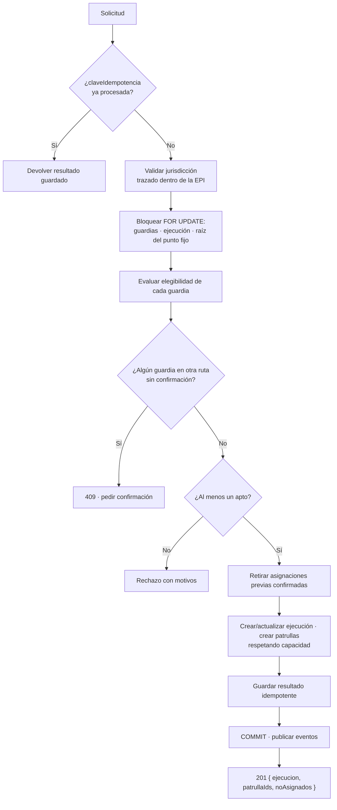
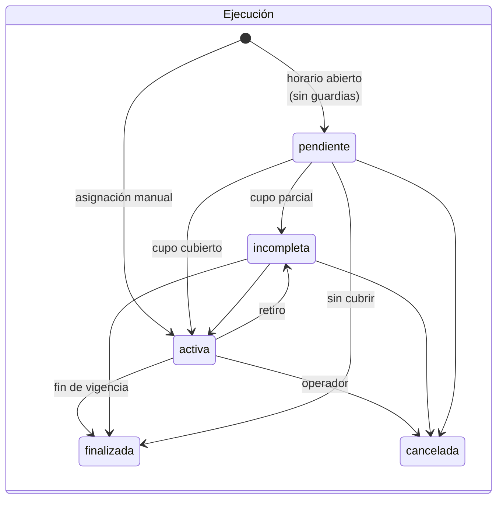
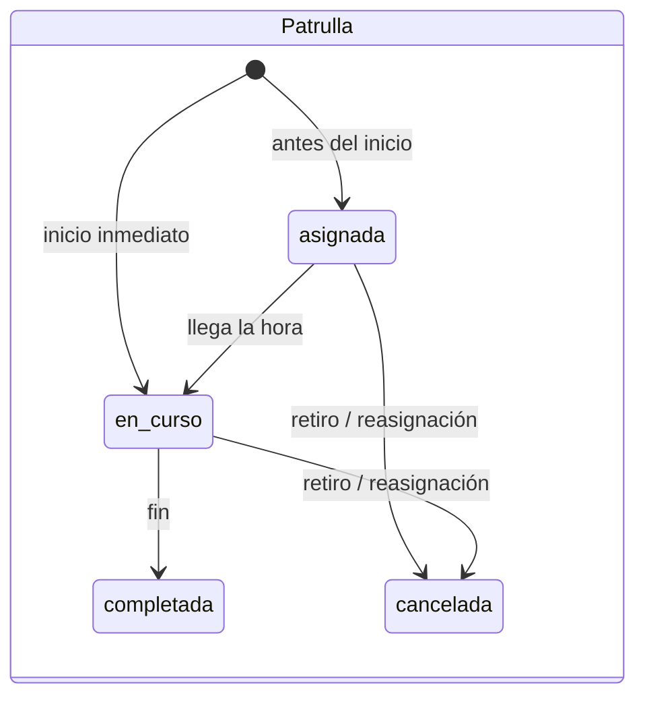
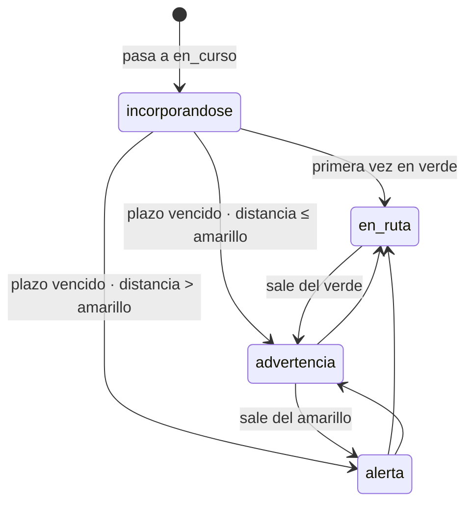
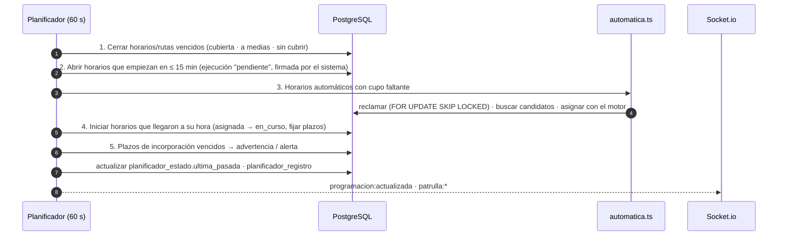

# 05 · Dominio de patrullaje

> **Alcance:** reglas de negocio del núcleo operativo — rutas, ejecuciones, puntos fijos, estado respecto a la ruta, plazos de incorporación, programación y asignación automática.
> **Audiencia:** backend, producto, QA.
> **Código:** `src/modules/ejecuciones/`, `src/modules/programacion/`, `src/modules/puntos-fijos/`, `src/modules/epis/`.

---

## 1. Glosario

| Término | Definición |
|---|---|
| **EPI** | Estación Policial Integral. Unidad territorial con polígono versionado (`epi_territorio`). Catálogo actual: Norte, Sur (código `sud`), Jaihuayco, Coña Coña, Alalay Sud, Central. |
| **Ruta plantilla** | Trazado guardado en la biblioteca: `establecida` (predeterminada), `guardada` o `dinamica` (creada al asignar). |
| **Ejecución** (`ruta_ejecucion`) | Una asignación concreta de una ruta o punto fijo a un grupo de guardias, con **copia del trazado**, modalidad, capacidad y ventana de vigencia. |
| **Patrulla** | La participación de **un** guardia en una ejecución. Un guardia tiene como máximo **una** patrulla activa (`ux_patrulla_guardia_activa`). |
| **Modalidad** | `coche`, `moto`, `a_pie`, `punto_fijo`, `oficina`. Define capacidad y umbrales de desvío. |
| **Punto fijo** | Lugar de custodia estática, con subpuntos opcionales y capacidad por hoja. |
| **Programación** | Plan semanal (ventanas por días/hora/duración/cupo) que el planificador convierte en ejecuciones. |
| **Horario** | Una ocurrencia concreta de una ventana en un día local: se materializa como ejecución con `programacion_id` y `fecha_local`. |

## 2. Parámetros operativos

Centralizados en `ejecuciones/config.ts` y `programacion/config.ts` — **ajustar ahí, nunca en la lógica**.

### 2.1 Capacidad y umbrales por modalidad

| Modalidad | Capacidad máx. | En ruta (verde) ≤ | Advertencia (amarillo) ≤ | Alerta (rojo) |
|---|---|---|---|---|
| `coche` | 12 | 100 m | 400 m | > 400 m |
| `moto` | 2 | 100 m | 300 m | > 300 m |
| `a_pie` | 3 | 50 m | 150 m | > 150 m |
| `punto_fijo` | 2 | 30 m | 100 m | > 100 m |
| `oficina` | 8 | 30 m | 100 m | > 100 m |

### 2.2 Programación y automática

| Parámetro | Valor |
|---|---|
| Zona horaria oficial | `America/La_Paz` |
| Apertura anticipada de un horario | 15 min |
| Intervalo del planificador | 60 s |
| Duración de un horario | 15 min – 24 h |
| Ventanas por programación / días de agenda | 14 / 14 |
| GPS válido para automática | Captura < 10 min, ≤ 120 s en el futuro, precisión ≤ 100 m |
| Batería mínima para automática | 15 % (y conocida) |
| Radio de búsqueda | 3 km inicial, +2 km cada 3 min sin candidatos, tope 20 km |
| Espera para reposición manual | 5 min |

## 3. Motor de asignación

`asignarEjecucion()` (`ejecuciones.service.ts`) atiende **una intención del operador en una sola transacción**.



**Garantías**

- **Atomicidad:** todo o nada; no quedan patrullas huérfanas.
- **Asignación parcial informada:** se asigna a los aptos; los demás se devuelven en `noAsignados` con su motivo.
- **Consentimiento explícito:** sacar a un guardia de otra ruta exige `confirmaciones[]`.
- **Concurrencia:** dos operadores que compiten por el último cupo quedan serializados por el bloqueo de fila.
- **Idempotencia:** la tabla `operacion_idempotente` guarda la huella de la petición y su resultado.
- **Snapshot:** el trazado se copia a la ejecución; editar o archivar la plantilla no altera lo asignado.

### 3.1 Puntos fijos

- Se asignan por la **identidad** del punto (no con un trazado fabricado).
- Un punto tiene **una sola ejecución abierta**; los nuevos guardias se suman a ella.
- La ocupación se cuenta en las **hojas** (subpuntos activos, o el punto si no tiene).
- Toda operación bloquea primero la **raíz** del punto (`FOR UPDATE`).
- Al mover o desactivar un punto ocupado: `politicaOcupados = trasladar | retirar`.

### 3.2 Ciclo de vida





## 4. Estado respecto a la ruta

Calculado **en el servidor en cada ping GPS** (`estadoRuta.ts`, función pura), para que exista aunque no haya pantallas abiertas.



- La distancia se mide al trazado (o al punto/subpunto asignado) con geometría propia, proyección equirectangular.
- Sin distancia conocida fuera del verde, el estado es **alerta** (falla hacia lo seguro).
- Cada transición emite `patrulla:estado_ruta` a la sala de la EPI.

### 4.1 Plazo de incorporación (F7)

Al pasar a `en_curso` cada patrulla recibe una **hora límite** desde la última posición conocida:

```
plazo = max(5 min, arranque + (distancia_recta × 1,35) / velocidad × factor_pesimista)
```

| Modalidad | Velocidad | Arranque | Factor pico / diurna / nocturna |
|---|---|---|---|
| `a_pie` | 1,25 m/s | 0 s | 1,20 / 1,20 / 1,15 |
| `moto` | 8,3 m/s | 30 s | 1,60 / 1,35 / 1,15 |
| `coche` | 8,3 m/s | 60 s | 2,30 / 1,60 / 1,25 |

Para `punto_fijo`/`oficina`: a pie hasta 1500 m, en vehículo más allá. Sin posición conocida, el plazo se fija con el primer ping. El planificador revisa los plazos vencidos cada minuto.

## 5. Programación y planificador



- **Recuperación tras reinicio:** el horario en curso se recupera; los que terminaron con el servidor caído solo quedan anotados (`omitidas`), no se abren a destiempo.
- **Multi-instancia segura:** un horario se identifica por (ventana, día local) con índice único; los inicios bloquean la ejecución.
- **Interruptor:** `PATCH /programaciones/planificador { habilitado: false }` (Super Admin) deja de **abrir** horarios; los cierres continúan. `DESACTIVAR_VENCIMIENTO_RUTAS=1` apaga el planificador completo en esa instancia (solo mantenimiento).
- **Relevo de punto fijo:** un horario que empieza con guardias releva la asignación anterior del punto.

## 6. Asignación automática (F6)

Para cada horario `automatica` abierto al que le faltan guardias:

1. **Reclamar** el horario con `FOR UPDATE SKIP LOCKED` y anotar el próximo intento.
2. **Calcular el radio** (3 km → +2 km cada 3 min sin éxito → tope 20 km).
3. **Buscar candidatos** (fuera de la transacción de escritura). Requisitos:
   - cuenta activa y turno abierto;
   - sin SOS abierto;
   - sin otra ruta (la automática **nunca** retira a nadie);
   - GPS de menos de 10 min, precisión aceptable, batería conocida ≥ 15 %;
   - dentro del radio;
   - no retirado manualmente de **este** horario (`retirado_por_usuario`, `reasignada`).
4. **Ordenar** por distancia a la ruta o punto; desempate estable por id.
5. **Asignar con el mismo motor**, que vuelve a comprobar los requisitos con los guardias bloqueados.
6. **Registrar** el intento en `asignacion_automatica_intento` (elegidos con distancia, descartados con motivo) y reintentar cada minuto hasta el fin del horario.

**Retiro en un horario automático** (`PATCH /mapas/patrullas/:id/cancelar`):

| `reposicion` | Comportamiento |
|---|---|
| `automatica` (por defecto) | Se busca al reemplazo más cercano inmediatamente |
| `manual` | El operador elige; el sistema espera hasta 5 min y luego continúa solo. `POST /programaciones/horarios/:id/reanudar` acelera la reanudación |

Quien sale por fin de turno se repone automáticamente. Auditable vía `GET /programaciones/horarios/:ejecucionId/automatica`.

## 7. SOS

- Una **alerta abierta** = fila de `guardia_telemetria` con `es_sos = true` y `sos_estado` nulo o `pendiente`.
- Al recibirla, el guardia pasa a `emergencia` y se emite `sos:nuevo` a todos los usuarios web, sin segmentación.
- `POST /guardias/:id/sos/atender` atiende **solo** las alertas indicadas; la fila conserva `es_sos = true` (historial) y pasa a `atendido`.
- Sin alertas abiertas, el estado operativo se deriva del turno real (no se fuerza `en_servicio`).
- Un guardia con SOS abierto no es elegible para la asignación automática.

## 8. Clasificación territorial

| Dato | Regla |
|---|---|
| Hecho / mandado | EPI que contiene su ubicación (sin tolerancia). Si cae fuera de cobertura, queda sin EPI y solo lo ve la supervisión global, que puede reclasificarlo (`PATCH /hechos/:id/epi`). |
| Guardia (EPI actual) | EPI de su última posición GPS válida (`guardia_ubicacion_actual`). Independiente de su EPI administrativa. |
| Ruta | El trazado completo dentro de la EPI del usuario (tolerancia 60 m). |
| Punto fijo | EPI de su ubicación; los subpuntos heredan la del punto. |

> Los territorios están **versionados** (`epi_territorio`): actualizar los límites de una EPI es publicar una nueva versión, sin cambios de código; la anterior queda como historial.
