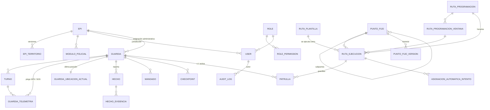

# 06 · Modelo de datos

> **Motor:** PostgreSQL 14+ (producción: Supabase, PostgreSQL 17) · **ORM:** Prisma 5
> **Fuente de verdad:** `prisma/migrations/*/migration.sql` (SQL escrito a mano) — `prisma/schema.prisma` refleja el esquema para el cliente tipado.
> **Convenciones:** tablas y columnas `snake_case` · PK `uuid` (`gen_random_uuid()`, extensión `pgcrypto`) · instantes `timestamptz` UTC · geometrías `jsonb` en GeoJSON `[lng, lat]` (WGS84) · sin PostGIS.

---

## 1. Diagrama entidad-relación (núcleo)

## 2. Diccionario por dominio

### 2.1 Catálogos y territorio

| Tabla | Propósito | Notas |
|---|---|---|
| `epi` | Estaciones Policiales Integrales | `codigo` único; `poligono` legado (usar `epi_territorio`); `activo` |
| `epi_territorio` | Territorio versionado de cada EPI | Único `(epi_id, version)`; el vigente define la jurisdicción |
| `modulo_policial` | Módulos policiales del inventario | Catálogo informativo |
| `tipo_hecho` | Tipos de incidente | Consumido por web y app |
| `zona_critica_activa` | Zonas de concentración de hechos | Recalculables (`POST /mapas/zonas/recalcular`) |

### 2.2 Identidad y acceso

| Tabla | Propósito | Notas |
|---|---|---|
| `role` | Roles web | `super_admin`, `admin`, `operador_monitoreo` |
| `role_permission` | Matriz RBAC | Único `(role_id, recurso)`; flags `puede_ver/crear/editar/eliminar` |
| `user` | Cuentas del personal | `estado`: `activo` · `inactivo` · `suspendido`; `epi_id` = jurisdicción |
| `guardia` | Guardias municipales | `estado`: + `pendiente_activacion`; `estado_operativo`: `fuera_de_servicio` · `en_servicio` · `emergencia` |
| `refresh_token` | Refresh tokens (hash SHA-256) | `sujeto_tipo` (`user`/`guardia`), `familia`, `reemplazada_por`, `revocado_en` |
| `password_reset` | Códigos de recuperación (hash) | Un solo uso, con expiración |
| `audit_log` | Bitácora | **Inmutable**: trigger `trg_audit_no_update` impide `UPDATE`/`DELETE` |
| `permiso_cambio_registro` | Cambios puntuales de permisos por migración | Para revertir |

### 2.3 Operación en campo

| Tabla | Propósito | Notas |
|---|---|---|
| `turno` | Turno del guardia (selfie de inicio, GPS inicio/fin) | Único: un turno abierto por guardia (`ux_turno_abierto_por_guardia`) |
| `guardia_telemetria` | Serie GPS + SOS | `id` bigserial (se serializa como string); `es_sos`, `sos_estado`, `bateria_pct` |
| `guardia_ubicacion_actual` | Última posición válida y EPI actual | Una fila por guardia |
| `hecho` | Incidente | `estado`: `reportado` · `en_revision` · `cerrado`; `nivel_riesgo`; `epi_id` por ubicación |
| `hecho_evidencia` | Fotos/videos | `tipo`: `foto` · `video`; URL pública en Cloudflare R2 |
| `hecho_epi_reclasificacion` | Valores anteriores de `epi_id` (0008) | Para revertir |
| `mandado` | Tarea registrada por el guardia | Con EPI por ubicación |
| `checkpoint` | Marca fotográfica de control | `estado`: `realizado` · `perdido` |

### 2.4 Patrullaje

| Tabla | Propósito | Restricciones clave |
|---|---|---|
| `ruta_plantilla` | Biblioteca de rutas | `tipo`: `establecida` · `guardada` · `dinamica`; `duracion_min` 15–10080; `capacidad` 1–50 |
| `ruta_ejecucion` | Asignación concreta (snapshot del trazado) | `estado`: `pendiente` · `activa` · `incompleta` · `finalizada` · `cancelada`; `origen`: `manual` · `programada` · `automatica` · `legado`; `creado_por_tipo`: `user` · `sistema` |
| `patrulla` | Guardia en una ejecución | `estado`: `asignada` · `en_curso` · `completada` · `cancelada`; `estado_ruta`; **único parcial** `ux_patrulla_guardia_activa` |
| `punto_fijo` / `punto_fijo_version` | Puntos fijos jerárquicos e historial | Capacidad por hoja |
| `ruta_programacion` | Plan semanal | Exactamente uno de `ruta_plantilla_id` / `punto_fijo_id`; `modo`: `manual` · `automatica`; `estado`: `activa` · `pausada` · `archivada` |
| `ruta_programacion_ventana` | Días, hora, duración, cupo | `dias ⊆ {1..7}`; `duracion_min` 15–1440; `cupo` 1–50 |
| `planificador_estado` | Fila única (`id = 1`) | `habilitado`, `ultima_pasada`, `ultimo_error` |
| `planificador_registro` | Una fila por pasada con cambios | Contadores y detalle |
| `asignacion_automatica_intento` | Auditoría de la automática | Elegidos, excluidos y motivos |
| `operacion_idempotente` | Resultado por `claveIdempotencia` | PK = clave (uuid); `huella` de la petición |

## 3. Objetos de base de datos

| Objeto | Tipo | Migración | Función |
|---|---|---|---|
| `set_updated_at()` | Trigger fn | 0001 | Mantiene `updated_at` |
| `audit_log_inmutable()` / `trg_audit_no_update` | Trigger | 0001 | Bitácora de solo inserción |
| `fn_haversine_m()` | Función | 0001 | Distancia en metros |
| `fn_turno_distancia()` | Función | 0001 → 0002 | Distancia del turno con filtro anti-ruido GPS |
| `fn_sos_a_emergencia()` / `trg_telemetria_sos_emergencia` | Trigger | 0002 | Un ping SOS pasa al guardia a `emergencia` |
| `fn_hecho_estado_cambiado()` / `trg_hecho_estado_cambiado` | Trigger | 0002 | Seguimiento de cambios de estado |
| `fn_gamc_en_anillo`, `fn_gamc_punto_en_geojson`, `fn_gamc_clasificar_punto` | Funciones | 0008 | Clasificación de puntos por EPI en SQL |
| `v_guardia_ubicacion_actual` | Vista | 0001 | Última posición |
| `v_sos_pendiente` | Vista | 0001 | SOS abiertos |
| `v_patrulla_vigente` | Vista | 0001 → 0007 | Patrullas vigentes (vigencia corregida en 0007) |

## 4. Índices relevantes para rendimiento

| Índice | Tabla | Consulta que sirve |
|---|---|---|
| `ix_tele_guardia (guardia_id, capturado_en)` | `guardia_telemetria` | Última posición / recorrido por guardia |
| `ix_tele_turno (turno_id, capturado_en)` | `guardia_telemetria` | Recorrido por turno |
| `ix_tele_sos` | `guardia_telemetria` | SOS recientes |
| `ix_ruta_ejecucion_vigentes (estado, fin)` parcial | `ruta_ejecucion` | Cierres del planificador |
| `ux_patrulla_guardia_activa` parcial único | `patrulla` | Una asignación activa por guardia |
| `ux_turno_abierto_por_guardia` | `turno` | Un turno abierto por guardia |
| `ix_hecho_ocurrido`, `ix_hecho_epi`, `ix_hecho_estado` | `hecho` | Bandeja y dashboard |
| `ix_audit_created`, `ix_audit_actor` | `audit_log` | Consulta de bitácora |

> Algunos índices existen en SQL pero no están declarados con `@@index` en `schema.prisma`. **No** usar `prisma db push` ni `prisma migrate diff` para regenerar migraciones: el SQL a mano es la referencia.

## 5. Historial de migraciones

| Migración | Fase | Resumen | Reversión |
|---|---|---|---|
| `0001_init` | Base | Esquema único web + móvil, roles, permisos, vistas, auditoría inmutable | — |
| `0002_distancia_antiruido` | — | Distancia de turno con filtro de ruido GPS | — |
| `0002_triggers_ayuda` | — | Triggers SOS → emergencia y cambio de estado de hechos | — |
| `0003_add_checkpoint` | — | Tabla `checkpoint` | — |
| `0003_ruta_plantilla_modalidad` | — | Modalidad en `ruta_plantilla` | — |
| `0004_user_epi_jurisdiccion` | EPI | `user.epi_id` | — |
| `0005_epi_poligonos` | EPI | Polígonos por EPI | — |
| `0006_epi_catalogo_inventario` | F1 | Catálogo v2, territorios versionados, módulos policiales | ✔ |
| `0007_ruta_ejecucion` | F2 | Motor de asignación, idempotencia, permisos `sos`/`rutas_establecidas` | ✔ |
| `0008_segmentacion_epi` | F3 | Segmentación, ubicación actual, reclasificación, permisos `dashboard`/`jurisdiccion_usuarios` | ✔ |
| `0009_puntos_fijos` | F4 | Puntos fijos, catálogo inicial, permiso `puntos_fijos` | ✔ |
| `0010_programacion_rutas` | F5 | Programaciones, ventanas, planificador, permiso `programacion_rutas` | ✔ |
| `0011_asignacion_automatica` | F6 | Columnas de automática e intentos | ✔ |
| `0012_plazo_incorporacion` | F7 | Plazo de incorporación en patrulla | ✔ |

Las reversiones están en `scripts/sql/revert/`. Para 0006–0012 existe además el script agregado `scripts/sql/entrega_f1_f7.sql` (y su `.revert.sql`), ejecutable en una única transacción.

### 5.1 Estándar de migraciones

Toda migración nueva debe:

1. Ser **aditiva** (tablas/columnas nuevas, nullable o con valor por defecto). Toda excepción se documenta en la cabecera y se aprueba.
2. Ser **idempotente** (`IF NOT EXISTS`, `ON CONFLICT DO NOTHING`).
3. Validar **precondiciones** (y abortar listando el problema sin corregirlo en silencio).
4. Terminar con un bloque de **verificación posterior** (`DO $$ … RAISE EXCEPTION … $$`).
5. Incluir su script de **reversión** en `scripts/sql/revert/NNNN_nombre.revert.sql`.
6. Actualizar `schema.prisma` para reflejar el cambio.
